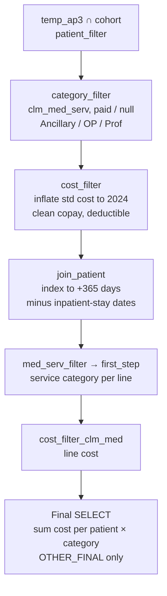

# Cost Burden — Outpatient, ED/ER, OT/PT and Other Medical Costs (Follow-Up Year 1)
 
**Data source:** Optum Market Clarity — Sjögren's / Graves' Disease Cohort
**Schema:** `market_clarity_graves_disease_202505_v1_20250728_prod`
**SQL dialect:** Trino / Presto (e.g., AWS Athena)
**Output grain:** One row per patient × cost category
**Companion document:** `README_HCRU.md` (visit counts using the same service categories)
 
---
 
## 1. Purpose
 
This query estimates **non-inpatient medical costs** per patient in the first year after the index date. Costs are inflated to **2024 US dollars**. They are grouped into the same service categories used for HCRU: outpatient services, ED/ER, OT/PT, and other services. As configured:
 
- **Period:** index date through index + 365 days (follow-up Year 1).
- **Scope:** **all-cause** medical service costs. Unlike the HCRU script, there is no SjD-diagnosis proximity filter.
- **Cost:** standardized cost inflated to 2024, plus patient copay and deductible.
- **Output category:** currently `OTHER_FINAL` only. The final filter selects one category per run.
Claims dated during inpatient stays are excluded. Pharmacy costs are not included.
 
---
 
## 2. Data Sources
 
### 2.1 Source tables (Optum Market Clarity)
 
| Table | Data type | Fields used |
|---|---|---|
| `argenx_graves_202505_clm_med_serv` | Medical claim service lines | `ptid`, `fst_dt`, `proc_cd`, `tos_cd`, `tos_ext`, `paid_status`, `std_cost`, `std_cost_yr`, `copay`, `deduct` |
 
The schema name indicates a **May 2025 data cut (`202505`), version 1, built 28 July 2025**. *(Inferred from the naming convention — confirm with the data engineering team.)*
 
### 2.2 Upstream dependencies
 
| Object | Role | Required columns |
|---|---|---|
| `step4_flagged_without_sicca` | Analytic cohort from Step 4 of the cohort build, with sicca-flagged patients removed | `ptid` |
| `temp_ap3` | Patient-level index date | `ptid`, `date_of_first_diagnosis` |
| `Sjd_med_serv_cost` | Pre-built medical service extract, used to find inpatient-stay dates | `ptid`, `fst_dt`, `paid_status` |
| `sjd_inp_confinement_cost` | Pre-built inpatient confinement extract | `ptid`, `admit_date`, `disch_date` |
 
The HCRU script reads inpatient confinements directly from `clm_inp_conf`. This script instead uses the two pre-built `sjd_…_cost` tables. **Confirm they are built from the same data cut.**
 
---
 
## 3. Processing Logic
 

 
| Step (CTE) | What it does |
|---|---|
| `patient_filter` | Index dates for cohort patients only. |
| `category_filter` | Medical service lines with paid or null status. Sets a cost class from `tos_cd`: `ANC.%` → Ancillary, `FAC_OP.%` → OP, `PROF.%` → Prof, and anything else → null. |
| `cost_filter` | Converts standardized cost to 2024 dollars (Section 5). Sets null or negative copay and deductible to 0. |
| `join_patient` | Keeps lines dated from index to index + 365, and removes lines on inpatient-stay dates. |
| `med_serv_filter` | Keeps the columns needed downstream. |
| `first_step` | Assigns each line a service category (Section 6). |
| `cost_filter_clm_med` | Calculates the cost of each line. |
| Final `SELECT` | Sums cost per patient and reporting group, then filters to `OTHER_FINAL`. |
 
---
 
## 4. Business Rules
 
**BR-01 — Cohort restriction.** The query includes only patients who are in both `step4_flagged_without_sicca` and `temp_ap3`.
 
**BR-02 — Payment status.** A claim line is kept if `PAID_STATUS` is null or `'P'` (Paid).
 
**BR-03 — Cost class.** The type-of-service code determines which inflation factor applies:
- `ANC.*` → Ancillary
- `FAC_OP.*` → OP (facility outpatient)
- `PROF.*` → Prof (professional)
Any other type of service, such as inpatient facility, gets a standardized cost of 0.
 
**BR-04 — Inflation to 2024.** `Std_cost_2024 = STD_COST × factor`. The factor depends on the cost class and the cost basis year (`STD_COST_YR`, 2004–2024); see Section 5. Years outside 2004–2024 get a standardized cost of 0.
 
**BR-05 — Patient cost share.** `copay` and `deduct` are used as recorded. Null or negative values are set to 0.
 
**BR-06 — Line cost.** The cost of each line is calculated as follows:
- If `Std_cost_2024` is greater than 0: cost = `Std_cost_2024` + copay + deductible.
- Otherwise: cost = copay + deductible.
**BR-07 — Follow-up window.** A line is kept if its service date (`fst_dt`) falls between the **index date and index + 365 days, inclusive** (366 calendar days).
 
**BR-08 — Inpatient exclusion.** A line is removed if its service date matches a paid medical claim date (in `Sjd_med_serv_cost`) that falls inside an inpatient confinement (in `sjd_inp_confinement_cost`). The admit and discharge dates are included.
 
**BR-09 — Service category.** Each line receives one category using the same ordered rules as the HCRU script (Section 6).
 
**BR-10 — Reporting groups.** The detailed categories are combined into reporting groups (Section 7). Costs are summed per patient and group.
 
**BR-11 — Output selection.** The final query returns only `category_first = 'OTHER_FINAL'`. Change the filter value, or remove it, to report other groups.
 
---
 
## 5. Inflation Factors (to 2024 USD)
 
Ancillary and Prof share one set of factors, and OP has its own.
 
| Cost year | Ancillary & Prof | OP (facility outpatient) |
|---|---|---|
| 2004 | 1.610 | 2.521 |
| 2005 | 1.533 | 2.334 |
| 2006 | 1.484 | 2.230 |
| 2007 | 1.463 | 2.105 |
| 2008 | 1.408 | 1.960 |
| 2009 | 1.368 | 1.856 |
| 2010 | 1.335 | 1.716 |
| 2011 | 1.291 | 1.632 |
| 2012 | 1.260 | 1.552 |
| 2013 | 1.227 | 1.485 |
| 2014 | 1.204 | 1.407 |
| 2015 | 1.185 | 1.337 |
| 2016 | 1.153 | 1.322 |
| 2017 | 1.142 | 1.252 |
| 2018 | 1.133 | 1.206 |
| 2019 | 1.120 | 1.201 |
| 2020 | 1.093 | 1.160 |
| 2021 | 1.065 | 1.130 |
| 2022 | 1.042 | 1.092 |
| 2023 | 1.023 | 1.041 |
| 2024 | 1.000 | 1.000 |
 
The factors appear to be based on medical-care price indices, with separate rates for professional services and hospital outpatient services. *(Confirm the source index and version, and record them here.)*
 
---
 
## 6. Service Category Mapping (Applied in Order)
 
The mapping is the same as in the HCRU script. In summary:
1. Procedure codes on the OT/PT list are checked first.
2. Next come ancillary types of service: DME, drug administration (excluding HCPCS `A` codes), home health/hospice, and transport.
3. Then facility outpatient types of service: ED/ER, diagnostic, lab, the `FO_OTH` sub-hierarchy, radiology, and surgery.
4. Then professional types of service: office visits, consults, ED/ER, diagnostics, lab/pathology, physical medicine, radiology, surgery, obstetrics, and other professional services.
5. Anything else becomes **Others**.
The full rule table and OT/PT code groups are in `README_HCRU.md`, Section 5.
 
---
 
## 7. Reporting Groups
 
The cost script groups categories differently from the HCRU script:
 
| Detailed category | Cost reporting group (`category_first`) |
|---|---|
| OP - ancillary/radiology, OP - Diagnostic | OP- ancillary/radiology/Diagnostic |
| Others, Home/hospice visit, Obstetrics | OTHER_FINAL |
| All other categories (e.g., OP - Physician office visit, OP - Lab/pathology, OP - Surgery, OP - drugs administration, OP - Physical Medicine/ Rehab, OP - Facility Others, OP - other professional services, ED/ER, OT/PT) | Keep their detailed name |
 
In the HCRU script, every `OP` category is rolled into a single "OP Visit" group. Here, the OP categories stay separate.
 
---
 
## 8. Output Specification
 
| Column | Description |
|---|---|
| `PTID` | Optum de-identified patient ID |
| `category_first` | Cost reporting group (currently always `OTHER_FINAL`) |
| `Total_cost` | Sum of line costs in 2024 USD during follow-up Year 1 |
 
To include patients with no costs, left-join the result to the cohort and set missing totals to 0.
 
---
 
## 9. Assumptions, Limitations, and Points for Review
 
Items marked **Action** should be resolved before results are shared.
 
**1. The header line will cause an error.** The line `— others, OTPT etc cost burden:` begins with an em dash, so it is not a valid SQL comment. **Action:** replace it with `--`.
 
**2. 2025 standardized costs are set to zero — high priority.** The inflation table stops at 2024, so any line with `STD_COST_YR = '2025'` (or a null year) gets `Std_cost_2024 = 0` and keeps only copay and deductible. The data cut runs to May 2025, so follow-up years ending in 2025 will be substantially understated. **Action:** add a 2025 factor (deflating to 2024 or re-basing to 2025), or apply 1.0 to years after the base year.
 
**3. Patient cost share may be counted twice.** If `STD_COST` already represents the full allowed amount (plan payment plus patient cost share), as is typical for Optum standardized costs, adding copay and deductible double-counts the patient's share. Coinsurance is not added at all, which is inconsistent with adding the other two. **Action:** confirm the `STD_COST` definition in the Optum data dictionary and adjust the formula.
 
**4. Costs may be under-counted after removing duplicates.** In `first_step`, `SELECT DISTINCT *` runs after the columns have been reduced to patient, date, procedure, TOS, status, and costs. Claim and line identifiers are no longer included. Two genuinely separate lines with identical values, such as repeated units billed on separate lines, are therefore merged into one and their cost is counted once. **Action:** keep `clmid` and the line number through to the cost sum, or remove the `DISTINCT`.
 
**5. Other types of service get zero standardized cost.** Lines whose `tos_cd` is not `ANC`, `FAC_OP`, or `PROF` receive zero standardized cost. This is mostly inpatient facility, which is intended, but any unexpected TOS values should be checked.
 
**6. Code values are not standardized before matching.** `tos_cd` is not trimmed or upper-cased in `category_filter`, unlike the categorization step, so values with padding or mixed case would get a null cost class. `STD_COST_YR` is compared as text (`'2004'`). If the column is numeric, the comparison may fail. **Action:** use `TRIM(UPPER(tos_cd))` and cast the year consistently.
 
**7. Scope and period differ from the HCRU script.**
- HCRU measures **SjD-related** (±7 days of a diagnosis) **baseline** visits.
- This script measures **all-cause** **follow-up** costs.
- The two scripts also use different reporting groups (Section 7).
**Action:** confirm the intended pairing, so that visits and costs are reported on the same basis.
 
**8. Different inpatient-exclusion sources.** This script uses the pre-built `Sjd_med_serv_cost` and `sjd_inp_confinement_cost` tables. The HCRU script uses the source tables directly. The two could disagree if the pre-built tables are out of date.
 
**9. Patients with zero cost are not in the output.** Use a cohort left join before calculating means.
 
**10. No enrollment check in this script.** The Year 1 totals assume the patient was enrolled for the full year. Patients who leave the plan or die during the year will show lower costs. **Action:** confirm that continuous enrollment through index + 365 is required upstream.
 
**11. Pharmacy and inpatient costs are excluded by design.** Total cost of care therefore needs separate inpatient and pharmacy components.
 
---
 
## 10. Suggested Quality Checks
 
1. Run without the final category filter, and check that the sum of all groups equals total non-inpatient medical cost.
2. Check the distribution of `STD_COST_YR` among follow-up lines, and the share with year 2025 or null (Section 9, item 2).
3. Compare costs with and without the final `DISTINCT` to measure the effect described in Section 9, item 4.
4. Calculate mean, median, and percentile cost per patient (including zero-cost patients), and compare against published per-patient outpatient costs for similar autoimmune populations.
5. Check how many lines and how much cost the inpatient exclusion removes.
---
 
## 11. Glossary
 
| Term | Definition |
|---|---|
| `STD_COST` | Optum standardized cost, which removes regional and payer price variation |
| `STD_COST_YR` | Pricing basis year of the standardized cost |
| Copay / deductible | Patient cost-sharing amounts on the claim line |
| TOS / `tos_cd` | Optum type-of-service code (`ANC` ancillary, `FAC_OP` facility outpatient, `PROF` professional) |
| Follow-up Year 1 | Index date through index + 365 days |
 
---
 
## 12. Document Control
 
| Field | Value |
|---|---|
| Owner | *TBD* |
| Reviewer | *TBD* |
| Data cut | May 2025 (`202505`), v1, built 2025-07-28 |
| Last updated | *TBD* |
 
